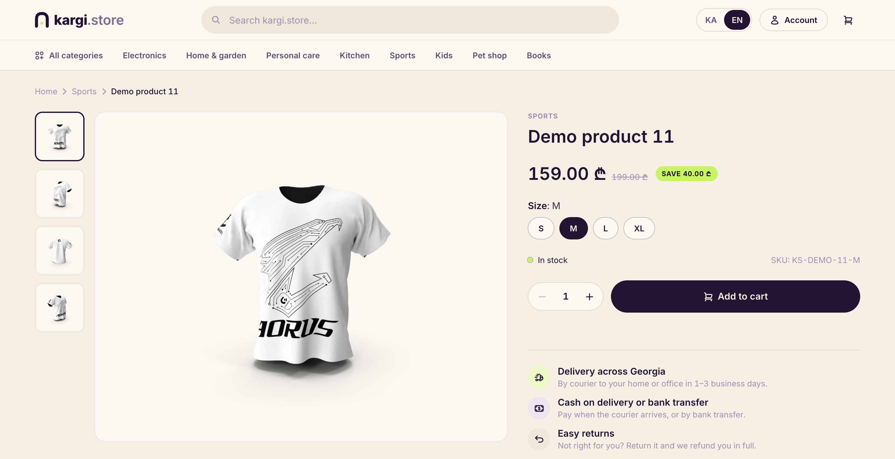
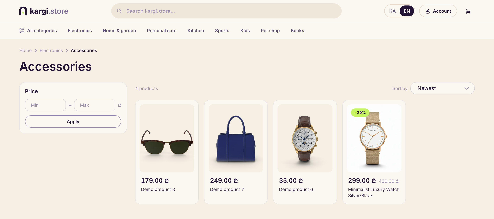
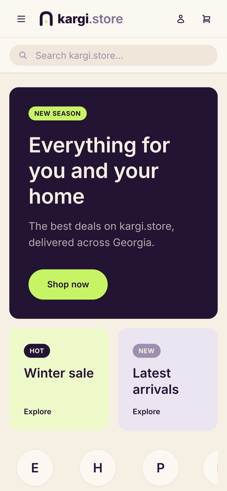
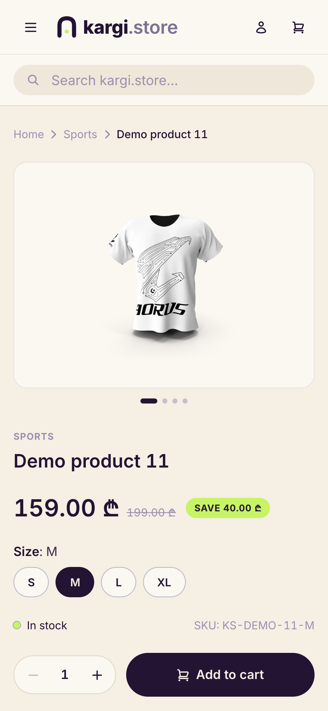
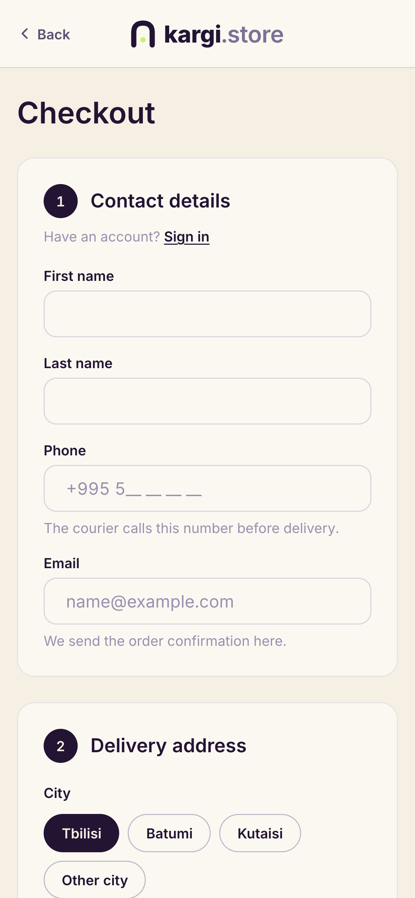
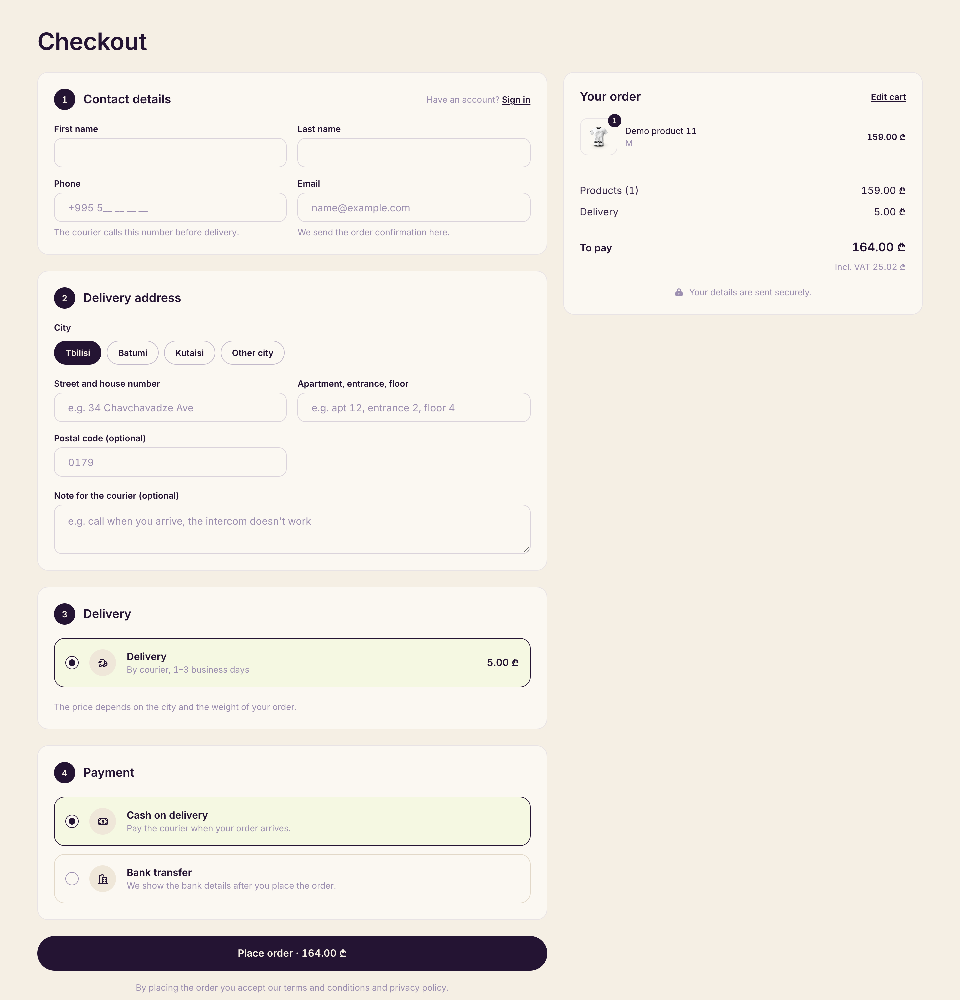
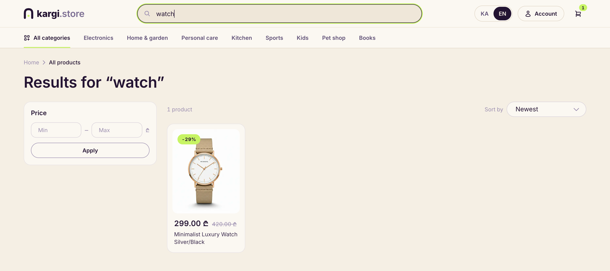
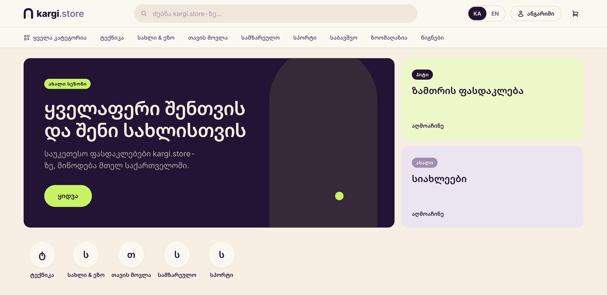

## What it is

kargi.store is a headless online store for a Georgian shop with a broad, mixed catalog. I'm building it alone, as free work for the owner, since September 2026: a Medusa backend and admin panel where the owner runs the shop, and a Next.js storefront for shoppers. The store hasn't opened yet; kargi.store shows a coming-soon page while the catalog is entered. Product photos and names in these screenshots are demo data.

## Stack

1. **Backend** Medusa v2.18 on Node, with Postgres and Redis. The Medusa admin is where the owner manages products, orders, payments and delivery rates.
2. **Storefront** Next.js 15 and React 19, styled with Tailwind and a small brand UI kit: design tokens plus reusable components that every page is built from.
3. **Two languages** next-intl for the `/ka` and `/en` interface, and Medusa's translation module for product data.
4. **Around it** Transactional email built with React Email and sent over SMTP, product images on Cloudflare R2, Docker images deployed with Coolify, and GitHub Actions CI started on demand.

## What shoppers get

- Georgian by default and English on `/en`. The language switcher keeps you on the same page.
- Prices in lari with 18% VAT included, so the price on the shelf is the price you pay.
- Search, price filters and sorting on every listing. Category pages include their sub-categories.
- A one-page checkout. Guest checkout, or an account with order history, saved addresses and email verification.
- Cash on delivery or bank transfer.
- Emails for order confirmation, payment received, shipped and cancelled, plus a new-order alert for the owner.
- A sitemap, structured data and share images, and Latin URLs for products with Georgian names.

Built mobile first, the same store on a phone:

## Challenges

1. **One catalog, two languages** The owner writes products in Georgian, the base language, and adds English in Medusa's translation module. The storefront sends the page's locale with every request, so Medusa returns English fields where they exist and Georgian where they don't. Interface text lives in next-intl message files with the same keys in both languages.
2. **Categories the index didn't know about** Listings and search run on Medusa's index engine, a Postgres copy of the fields the store filters and sorts on, so there's no separate search service to host. But the index only links products to a category when the category is created: products added or moved later never appeared on category pages. Category membership now comes from the product module, active sub-categories included, and is passed to the index query as a list of ids. Integration tests cover products created and moved at runtime.
3. **Search while typing Georgian** Full-text search matches whole words, so a half-typed Georgian word finds nothing. Search is a case-insensitive substring match on title, subtitle and handle instead, with the words kept in order. At hundreds to a few thousand products, Postgres answers in milliseconds.
4. **Delivery by city and weight** One delivery option, priced as a base fee for the city's zone plus a rate per kilogram above an included weight. City names match in either language, and an item without a weight counts as a default weight, so a missing value never makes delivery cheaper. The owner edits zones and rates in the admin without a deploy. The cart says "calculated at checkout", and checkout shows the price for the chosen city.
5. **Manual payments as real payment providers** Cash on delivery and bank transfer are Medusa payment providers, not notes on an order. Cash is authorised at checkout and captured when the courier collects it. A transfer order waits as "awaiting payment" until the owner confirms the money in the admin, and a daily job can cancel unpaid orders after a set number of days. Each method can be switched off from the admin.
6. **Admin edits without stale pages** The storefront caches catalog data under shared tags. A backend subscriber turns product, price, stock, category and translation events into one revalidation call per burst, so changes show up within moments and a bulk import doesn't flood the storefront. Resized product images are cached for 30 days, and Cloudflare keeps a separate copy per format, so browsers without WebP still get a JPEG or PNG.

## Status

In progress. The store runs on a private staging server. Launch is waiting on the owner's catalog, delivery rates and bank details. Instant navigation, with loading skeletons and prefetched catalog links, is built on a branch and not merged yet.
