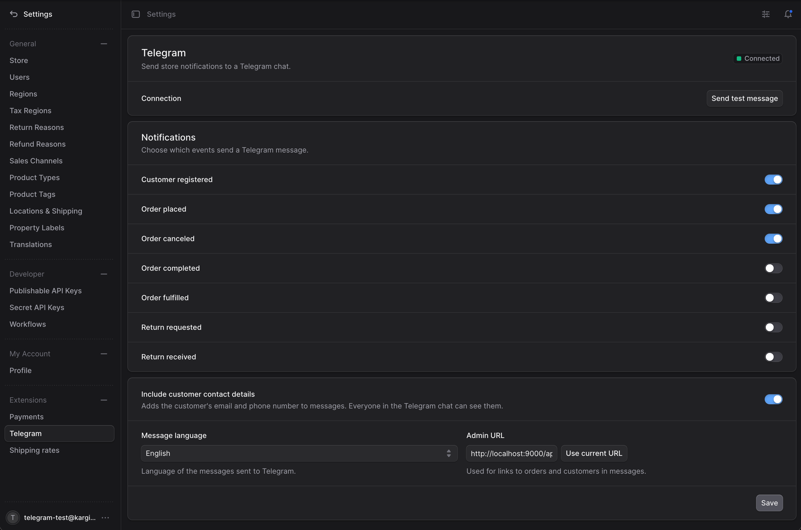

## What it does

A Medusa v2 plugin that tells sellers the moment something happens in their store. A Telegram bot posts a message to the shop's chat, a group or a channel, when a customer signs up, an order is placed, canceled, completed or shipped, or a return is requested or received. Each message has the order number, the customer, the total in the order's currency and a link that opens the order in the admin.

I built it for [kargi.store](/projects/kargi-store), where it's installed and running, and published it on npm so any Medusa store can use it.

Everything except the bot token and chat ID is set from a **Settings → Telegram** page in the Medusa admin: which events are sent, the message language, the admin URL for links, and whether the customer's email and phone are included.



## Why it's useful

- **Instant, on the phone** Sellers don't have to keep the admin open or wait for an email. A new order buzzes their phone within seconds, with a push notification from an app they already use all day.
- **The whole team sees it** Add the bot to a group or channel and everyone who handles orders, packing or delivery gets the same message at the same time. No shared admin logins just to keep an eye on orders.
- **One tap to act** "Open in admin" goes straight to the order or customer, so a seller can confirm, ship or cancel without searching.
- **Set up in minutes, free** A bot from @BotFather, a chat ID and one entry in `medusa-config.ts`. No third-party service, no subscription; the plugin talks to the Telegram Bot API directly.
- **Fits the shop** Messages come in the seller's language, Georgian included, and the owner chooses which events are worth a ping.

## Getting started

```shell
# Medusa v2.19 or newer
$ npm install @nkavt/medusa-plugin-telegram

# add it to plugins in medusa-config.ts with botToken and chatId, then
$ npx medusa db:migrate
```

Create a bot with @BotFather, add it to a chat, and read the chat ID from `getUpdates`. The settings page has a *Send test message* button that shows Telegram's own error if the setup is wrong, like `chat not found`.

## How it works

A Medusa module, a subscriber, two admin API routes and an admin settings page, all shipped in one package.

1. **One subscriber, many events** A single subscriber listens to seven customer and order events, checks the saved settings, loads the order or customer through Medusa's query graph and sends one message. Fulfillment and return events carry `order_id` instead of `id`, so both are handled.
2. **Settings in the database, secrets in config** The bot token and chat ID stay in plugin options from the environment. Everything the owner might change lives in a one-row settings table, edited through a workflow, so there's no redeploy to turn an event off.
3. **35 languages** Messages come in every Medusa Admin language plus Georgian, and the settings page follows the admin user's dashboard language. Totals are formatted in the order's currency and the message's locale.
4. **Links that work** "Open in admin" links point at the order or customer. The admin URL is read from the settings page itself, so there's no env var to set, and links to non-public hosts like `localhost` are sent as plain text because Telegram refuses them as buttons.
5. **Privacy switch** Bot messages are not end-to-end encrypted and everyone in the chat sees them. Turning off *Include customer contact details* leaves email and phone out, so the chat can be shared with people who shouldn't see customer data.
6. **Never breaks checkout** Sending runs after the event, never throws, and times out after 10 seconds. A failure is logged with Telegram's reason, like a bot kicked from the group, and the store carries on.

## Contributing

Version 0.1, released on npm in October 2026. Issues and pull requests are welcome on GitHub. CI runs lint, typecheck, build, unit tests, and integration tests against Postgres on every pull request.
